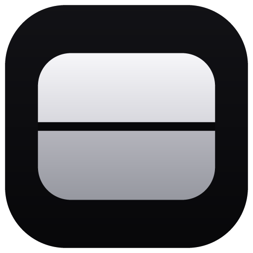
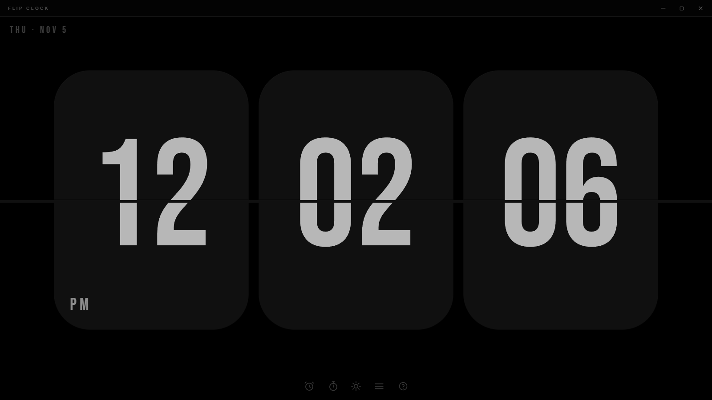
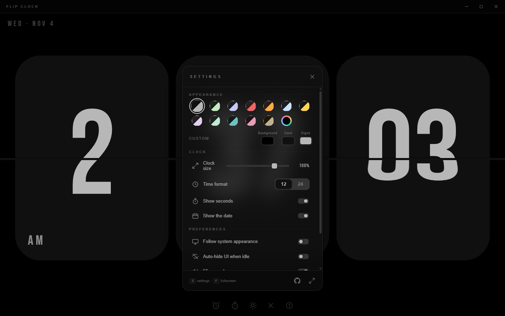
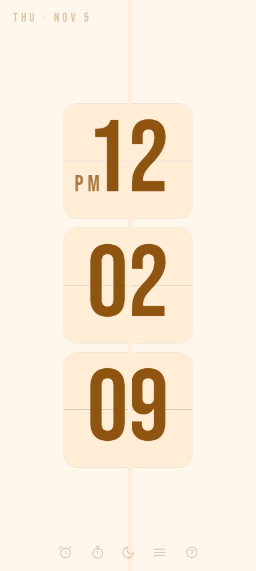
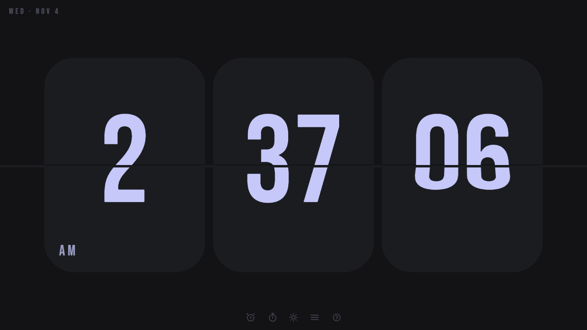
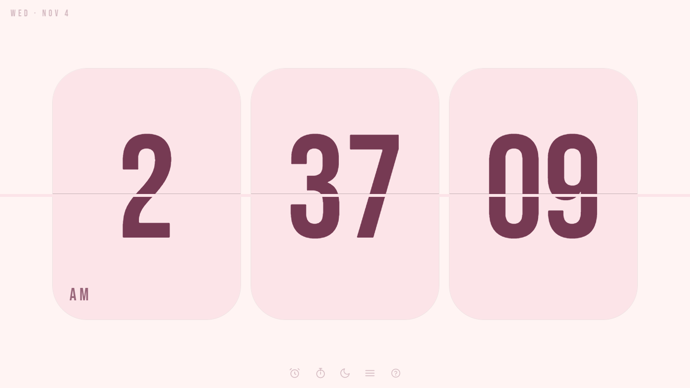
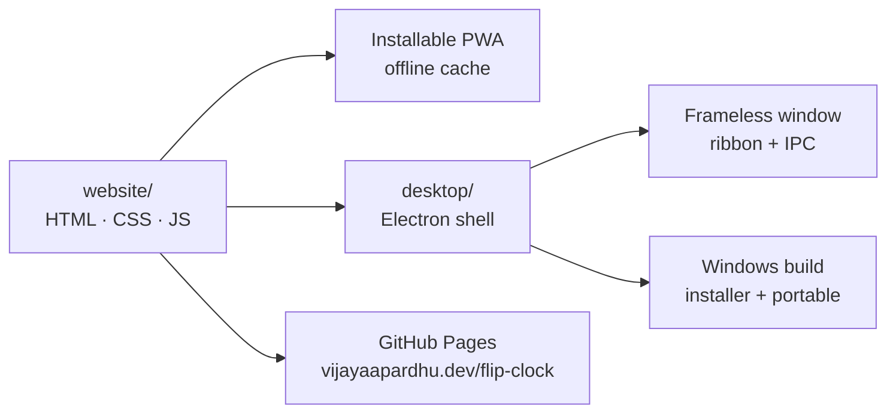

<div align="center">



<h1>Flip Clock</h1>

<p><strong>A minimal, hypnotic flip clock for focus and relaxation.</strong><br />
Three flat cards, a crisp centre seam, and a real top-to-bottom flip.<br />
On the web, offline, and as a frameless Windows app.</p>

<p>
  <a href="https://vijayaapardhu.dev/flip-clock/"></a>
  <a href="https://github.com/Vijayapardhu/flip-clock/releases/latest"></a>
  <a href="LICENSE"></a>
  <a href="https://github.com/Vijayapardhu/flip-clock/actions/workflows/release.yml"></a>
  
  
</p>

<p>
  <a href="https://github.com/Vijayapardhu/flip-clock/releases/latest"></a>
  <a href="https://vijayaapardhu.dev/flip-clock/"></a>
  <a href="https://github.com/Vijayapardhu/flip-clock"></a>
</p>

<a href="https://vijayaapardhu.dev/flip-clock/">
  
</a>

<sub>The desktop shell at 1600 × 900. Click the image to open the live clock.</sub>

</div>

---

Flip Clock is deliberately quiet: no account, no feed, no dashboard. Just the time, a date, and three oversized cards that turn over once a second. It is built as a single static website and reused inside a thin Electron shell, so the browser, the installed PWA, and the Windows app all feel like the same object.

## Download

The Windows build is a small installer or a portable `.exe`; the web app installs from the browser and works offline.

| Build | What you get |
| --- | --- |
| **Installer** | `FlipClock-Setup-1.4.0.exe` — Start menu and desktop shortcuts, uninstaller included. |
| **Portable** | `FlipClock-1.4.0-portable.exe` — one file, no installation; run it from anywhere. |
| **Web / PWA** | [vijayaapardhu.dev/flip-clock](https://vijayaapardhu.dev/flip-clock/) — add it to your home screen for a full-screen, offline clock. |

All builds target **Windows x64** and are unsigned. SmartScreen may ask you to confirm the first launch — choose **More info → Run anyway**, or build from source below.

## Features

<table>
  <tr>
    <td align="center" width="33%">
      <h3>🃏</h3>
      <b>Real flip motion</b><br />
      <sub>The top half falls, the bottom half catches. No cross-fades, no shortcuts.</sub>
    </td>
    <td align="center" width="33%">
      <h3>🎨</h3>
      <b>Twelve palettes</b><br />
      <sub>From monochrome and Iris to Amber and Rose — plus your own custom colours.</sub>
    </td>
    <td align="center" width="33%">
      <h3>⏱️</h3>
      <b>Clock, timer, stopwatch</b><br />
      <sub>Three modes in one surface. Switch with a key or a single tap.</sub>
    </td>
  </tr>
  <tr>
    <td align="center" width="33%">
      <h3>🌗</h3>
      <b>Light, dark, or automatic</b><br />
      <sub>Follow the system or pin a mode. The palette is painted before the first frame.</sub>
    </td>
    <td align="center" width="33%">
      <h3>📱</h3>
      <b>Made for every screen</b><br />
      <sub>Three cards across on desktop, three stacked cards on a phone, nothing cropped.</sub>
    </td>
    <td align="center" width="33%">
      <h3>📴</h3>
      <b>Truly offline</b><br />
      <sub>A service worker keeps the shell, fonts and icons cached after the first visit.</sub>
    </td>
  </tr>
</table>

The details matter too: 12/24-hour format, optional seconds, a generated flip sound, auto-hiding controls, fullscreen, and a settings sheet that never covers more than it needs to.

## Screenshots

<table>
  <tr>
    <td align="center" valign="top" width="70%">
      
      <br />
      <sub>One quiet sheet for palettes, size, format and preferences.</sub>
    </td>
    <td align="center" valign="top" width="30%">
      
      <br />
      <sub>Three stacked cards on a phone.</sub>
    </td>
  </tr>
</table>

No mockups or static recreations — every image here is a capture of the real app. The desktop shot uses the frameless shell; the phone shot uses the plain website at 427 × 952.

## Themes

<table>
  <tr>
    <td align="center" width="50%">
      
      <br />
      <sub><b>Iris</b> · dark</sub>
    </td>
    <td align="center" width="50%">
      
      <br />
      <sub><b>Rose</b> · light</sub>
    </td>
  </tr>
</table>

The theme picker includes the original monochrome look, Willow, Iris, Ember, Amber, Glacier, Citrine, Orchid, Mint, Lagoon, Rose and Sand. Every one has a dark and a light reading; the custom colour picker can take the background, card and digits anywhere else.

## Controls

| Key | Action |
| :---: | --- |
| <kbd>F</kbd> | Fullscreen |
| <kbd>S</kbd> / <kbd>,</kbd> | Open or close settings |
| <kbd>T</kbd> | Timer |
| <kbd>W</kbd> | Stopwatch |
| <kbd>C</kbd> | Back to the clock |
| <kbd>M</kbd> | Mute or unmute the flip sound |
| <kbd>?</kbd> | Shortcut sheet |
| <kbd>Esc</kbd> | Close a panel or leave fullscreen |

Everything is also reachable from the toolbar at the bottom of the screen. Fullscreen hides the toolbar and the desktop ribbon, leaving only the cards.

## Run it locally

**Requirements:** Node.js 20 or newer.

```powershell
git clone https://github.com/Vijayapardhu/flip-clock.git
cd flip-clock
npm install

npm start          # frameless Windows app
npm run serve      # website at http://localhost:3000
```

The original Electron-only renderer is preserved in `src/` for reference and still runs with `npm run start:classic`. The product UI lives in `website/`.

## The desktop shell

The Windows app is the same website in a deliberately thin wrapper: a 100% frameless `BrowserWindow`, a tiny preload bridge, and no duplicated frontend.

| | |
| :--- | :--- |
| **Default window** | 1180 × 760 |
| **Minimum window** | 380 × 560 |
| **Titlebar** | Custom ribbon (`?shell=1`) that follows the active palette |
| **Native menu** | Removed; the page draws its own minimise, maximise and close |
| **Links** | Open in the default browser; the clock never navigates away |
| **Fullscreen** | <kbd>F</kbd> / <kbd>F11</kbd>; the ribbon hides and the date returns to the top |
| **Icon** | Generated from the same flip-card artwork as the app |

The ribbon exists only inside the desktop shell. A normal browser gets the clean, chrome-free page with no window controls at all.

## Build the Windows app

```powershell
npm run dist
```

Outputs land in `dist/`:

| Output | Description |
| --- | --- |
| `FlipClock-Setup-1.4.0.exe` | NSIS installer with Start menu and desktop shortcuts. |
| `FlipClock-1.4.0-portable.exe` | Portable build that runs without installing. |
| `latest.yml`, `*.blockmap` | Release metadata and differential download support. |

To refresh the executable icon after changing the card artwork:

```powershell
npm run icon:app     # build/icon.ico + build/icon.png
```

## Architecture

One UI, two delivery vehicles. The desktop app loads the exact same `website/index.html`; only the outer shell differs.



- `themes.js` resolves the palette and light/dark mode **before** paint, so there is no flash of the wrong theme.
- `app.js` owns the clock, timer, stopwatch, settings, keyboard shortcuts, and the small `window.desktop` bridge.
- `service-worker.js` caches same-origin GETs and serves the cached shell when offline.
- `desktop/main.js` removes the native menu, applies the window limits, and loads `index.html?shell=1`.

### Project layout

```
flip-clock/
├─ website/                  # website + PWA — the only UI
│  ├─ index.html
│  ├─ styles.css             # card geometry, themes, responsive layout
│  ├─ app.js                 # clock, timer, stopwatch, settings, shell bridge
│  ├─ themes.js              # palettes and pre-paint light/dark handling
│  ├─ sounds.js              # generated flip and chime sounds
│  ├─ service-worker.js      # offline cache
│  ├─ manifest.webmanifest
│  └─ assets/                # fonts and generated icons
├─ desktop/                  # frameless Electron wrapper
│  ├─ main.js
│  └─ preload.js
├─ scripts/                  # icon generators, smoke tests, doc captures
├─ docs/                     # README screenshots
├─ build/                    # icon.ico / icon.png for the packaged app
├─ src/                      # legacy Electron renderer (reference)
├─ .github/workflows/        # Pages deploy + tagged release builds
└─ package.json              # scripts + electron-builder config
```

## Release

Versions are driven by `package.json`. Pushing a matching tag builds the Windows app once, creates a single GitHub Release with the installer, portable build, blockmap and `latest.yml`, then deploys `website/` to GitHub Pages:

```powershell
# set "version" in package.json first, e.g. 1.4.0
git tag v1.4.0
git push origin main v1.4.0
```

The workflow verifies that the tag matches `package.json`, so a stale tag cannot publish the wrong build. To re-publish an existing tag, run **Actions → Release → Run workflow** and enter the tag.

## Notes

- Store state — theme, mode, format, seconds, mute and timer presets — lives in `localStorage`.
- The service worker only caches same-origin GETs; there are no accounts, analytics, or third-party requests.
- Builds are unsigned. Windows SmartScreen may ask for confirmation on first launch.
- `.pen` files, if present, are encrypted design sources and are not needed to build or run the app.

## License

MIT © [Vijayapardhu](https://github.com/Vijayapardhu). See [LICENSE](LICENSE).

---

<div align="center">
  <sub>If this clock helps you focus, a ⭐ helps other people find it.</sub>
</div>
